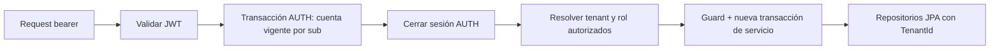

# Implementation Plan: Núcleo de gestión multi-gimnasio

**Branch**: `001-gym-management-core` | **Date**: 2026-11-10 | **Spec**: [spec.md](spec.md)

**Input**: Spec aprobada tras clarify, constitución 1.0.0 y
[plan de producto](../../docs/PLAN_DE_TRABAJO.md).

**Status**: Propuesta técnica pendiente de aprobación. No habilita implementación.

## Summary

Un monolito Spring Boot 3 con API REST, capas controller/service/repository y una
base PostgreSQL compartida. Hibernate 6.6 aplica @TenantId al negocio; la identidad
global se resuelve antes de abrir la transacción tenant. Un guard de infraestructura,
FK compuestas y pruebas reales de dos gimnasios cierran las vías de acceso previstas.

La feature cubre alta de gimnasio/primer ADMIN, acceso, recepción, catálogos, clientes,
compras de un detalle, renovaciones únicas, pagos parciales y anulaciones conservadas.
No incluye reservas, próximos vencimientos, pantallas, importación ni deploy público.
Las decisiones y alternativas están en [research.md](research.md); el diseño de
entidades en [data-model.md](data-model.md) y los contratos en [contracts/api.md](contracts/api.md).

## Technical Context

**Language/Version**: Java 21; Maven Wrapper 3.9.11.

**Primary Dependencies**: Spring Boot parent 3.5.16, Spring Data JPA, Hibernate 6.6.53.Final,
Spring Security 6.5.11, Web MVC, Bean Validation, resource-server/Jose para JWT,
springdoc-openapi 2.10.0. Versiones gestionadas por parent salvo springdoc y JaCoCo.
No se agregan Thymeleaf/HTMX hasta la feature 3.

**Storage**: PostgreSQL 17.11, mismo tag/digest de imagen en Compose y Testcontainers.
Flyway core y flyway-database-postgresql 11.7.2; pgjdbc 42.7.11. Hibernate valida el
esquema; solo Flyway lo crea/evoluciona. Una DataSource y una EntityManagerFactory.

**Testing**: JUnit 5.12.2 y Mockito 5.17.0; Surefire/Failsafe 3.5.6; Testcontainers
1.21.4 y PostgreSQL real; JaCoCo 0.8.16 con gate de 80% LINE/COVEREDRATIO en negocio.
Se combinará cobertura unitaria e integración; no se publicará un porcentaje antes de medirlo.

**Target Platform**: Aplicación JVM, desarrollo local Linux/Windows/macOS con Docker;
GitHub Actions con Java 21. Entorno observado: Java 17, Docker Server 29.1.3,
sin Maven ni PowerShell en PATH. M0 entrega Wrapper; se necesita seleccionar/instalar
Java 21 antes de verificar en host. Esta etapa no instala herramientas.

**Project Type**: Un módulo Maven en polygim-api/, paquete com.gymplatform,
controller → service → repository, con model/security/tenant/config de soporte.

**Performance Goals**: Sin SLA ni carga máxima acordados. Listados paginados con
size 20 por defecto y máximo 100; sin N+1 en respuestas de compras/pagos. Registrar
latencia observada de los escenarios en M7 sin inventar una garantía de producción.
No se exige infraestructura de load testing para esta feature.

**Constraints**: BigDecimal/NUMERIC(19,2), escala exacta 2 sin redondeo de entrada;
Clock uniforme por instalación; no SQL nativo/JDBC/bulk de negocio, root tenant,
OSIV, L2/query cache, entidades detached de DTO ni cambios de tenant en sesión abierta.
JWT por email global, comprobación de habilitación actual por request, errores RFC 7807.

**Scale/Scope**: Instalación de desarrollo/demostración, al menos dos gimnasios en
fixtures de integración, sin límite comercial de tenants incorporado. 8 historias,
32 requisitos funcionales y 6 constitucionales. Sin trabajos async de negocio.

## Constitution Check

*GATE: evaluación inicial antes de research y reevaluación después del diseño.*
Los estados siguientes acreditan coherencia del diseño, no pruebas de implementación.

| Control | Antes de investigación | Después de diseño / evidencia |
|---|---|---|
| Constitución y spec aclarada aprobadas | Cumple: solicitud del autor de iniciar plan | Se conserva alcance, spec con aprobación registrada |
| Capas y ubicación del código | Cumple | Estructura concreta debajo; lógica en service y políticas verificables |
| Aislamiento automático y tenant autorizado | Obligatorio | R2–R4, @TenantId y guard central; M1 bloquea el resto hasta demostrarlo |
| Alcance concreto de @TenantId | A investigar | Tag exacto confirma filtrado por ID; native/proxy/merge acotados; M1 pendiente de ejecución |
| Dos tenants e integración real | Obligatorio | Gate M1 y escenarios quickstart; no se sustituyen por mocks |
| Configuración por gimnasio y seed como datos | Cumple | Configuración persistida, cargador genérico opt-in sin nombres en clases |
| Legacy de dominio, sin copia de código | Cumple | Modelo reescrito, dirección y detalle como value objects embebidos |
| Precisión monetaria | Obligatorio | BigDecimal, NUMERIC(19,2), UNNECESSARY, money strings; snapshots |
| Unitarias y cobertura ≥80% de negocio | Obligatorio | Surefire/Failsafe + JaCoCo en verify/CI, alcance de clases explícito |
| RFC 7807, incluidos errores de Security | Obligatorio | Contrato de errores, handlers Security y ControllerAdvice y pruebas |
| Flyway y ausencia de DDL manual | Cumple | V1–V6 propuestas, ddl-auto=validate, pruebas vacío/actualización |
| Secretos por entorno | Cumple | Variables de quickstart; sin credenciales en scripts, SQL o seed |
| Aprobación del plan antes de tasks | Obligatorio | Se entrega como propuesta, no se crea tasks.md ni código del producto |

**Resultado del gate de diseño:** sin violaciones constitucionales ni decisiones de
producto pendientes que impidan planificar. **Gate de ejecución M1 aún no aprobado:**
se debe ejecutar sobre la combinación real de versiones antes de M2–M7. Si falla,
se corrige el mecanismo o se revisa el plan; no se avanza por un test upstream.

## Project Structure

### Documentation (this feature)

```text
specs/001-gym-management-core/
├── spec.md
├── plan.md
├── research.md
├── data-model.md
├── quickstart.md
├── contracts/
│   ├── api.md
│   └── openapi.yaml
└── checklists/requirements.md
```

`tasks.md` se genera solo después de aprobar este plan, mediante speckit-tasks.

### Source Code (repository root)

Estructura prevista; los archivos del producto todavía no existen:

```text
compose.yaml
.env.example
.github/workflows/verify.yml
polygim-api/
├── pom.xml
├── mvnw, mvnw.cmd, .mvn/wrapper/
├── Dockerfile
├── legacy/                         # Referencia existente, no código ejecutable
└── src/
    ├── main/
    │   ├── java/com/gymplatform/
    │   │   ├── GymManagementApplication.java
    │   │   ├── controller/         # Auth, plataforma y endpoints del gimnasio; DTOs y errores
    │   │   ├── service/            # Casos de uso, transacciones y políticas/calculadoras
    │   │   ├── repository/         # Persistencia tenant e identidad global encapsulada
    │   │   ├── model/              # Entidades y value objects, sin lógica HTTP
    │   │   ├── security/           # JWT, PasswordEncoder, cuenta vigente y handlers 401/403
    │   │   ├── tenant/             # Contexto, resolver, guard, scopes y aprovisionamiento
    │   │   ├── config/             # Clock y configuración de infraestructura
    │   │   └── seed/               # Cargador genérico opt-in
    │   └── resources/
    │       ├── application.yml
    │       ├── db/migration/       # V1–V6
    │       └── seed/gimnasios-demo.yml
    └── test/java/com/gymplatform/
        ├── service/                # Unitarias: importes, fechas, roles y reglas
        ├── security/               # Contratos de acceso y formato de error
        └── integration/            # *IT: aislamiento, integridad y concurrencia reales
```

**Structure Decision**: monolito en capas, sin módulos/deploys por gimnasio ni SPA.
Los DTOs no son entidades JPA. Direccion y DetallePedido son embebidos en Cliente y
Pedido: respetan el dominio sin tablas con identidad innecesaria. La identidad
CuentaAcceso es global privada; UsuarioGimnasio hace de frontera tenant para el personal.

### Flujo de identidad y tenant



AUTH/PLATFORM usan sentinel reservado no-root; no acceden a servicios de negocio.
El alta de un gimnasio usa un ejecutor especial con UUID nuevo y transacción propia
para persistir sus vínculos tenant de forma atómica. Su autorización especial solo
permite crear ese gimnasio nuevo y sus registros iniciales: no pasa por el guard
ordinario de negocio ni concede acceso a un tenant existente. M1 prueba esa frontera.
Ver R3/R4 antes de implementarlo.
Una vez abierta una sesión no se cambia su tenant; al terminar se limpia contexto.

### Transacciones y consultas

- Reads dentro de service @Transactional(readOnly=true), DTO completo antes de cerrar.
- Writes dentro de service @Transactional; create mediante persist explícito,
  update mediante entidad managed y dirty checking. No exponer JpaRepository completo
  como API de aplicación ni llamar save con entidades construidas desde requests.
- Lookup de IDs ajenos produce el mismo 404 que IDs inexistentes. Rol insuficiente
  se evalúa antes y da 403 sin revelar recursos.
- Cobro y anulación bloquean el pedido padre, después leen pagos no anulados y escriben.
- Renovar bloquea antecedente y comprueba sucesor, misma membresía/cliente y fechas;
  FK tenant y unicidad en DB respaldan las comprobaciones.
- Los estados calculados se consultan con agregación paginada o consultas acotadas,
  sin recorrer lazy collections por cada fila ni persistir flags duplicados.
- No se habilitan endpoints de edición/borrado de compras o pagos; el catálogo y
  clientes se editan sin perder IDs, tenant, snapshots o relaciones históricas.

### Secuencia de entrega prevista (sin generar tareas aún)

| Hito | Alcance y gate |
|---|---|
| M0 Base | Wrapper/Java 21, Maven, Compose/PostgreSQL, V1 inicial, errores, CI y configuración por entorno |
| M1 Aislamiento primero | V2 identidad/gimnasio/vínculo/configuración inicial, Security/JWT, resolver/guard y gate de dos tenants; bloquear demás hitos hasta verde |
| M2 Plataforma y recepción | Alta atómica de gimnasio/primer ADMIN; crear/deshabilitar recepción y comprobar permisos/cuenta vigente |
| M3 Catálogos | V3 disciplinas, membresías, canales y localidades; edición de cantidad máxima de compra |
| M4 Clientes | V4, alta mínima y edición, DNI propio único, catálogos opcionales propios |
| M5 Compras | V5, snapshots, calendario, renovaciones encadenadas únicas y prueba de concurrencia |
| M6 Pagos | V6, parcial/exacto/exceso, lock de pedido, anulaciones y deuda/estados calculados |
| M7 Cierre | Seed ficticio opt-in, OpenAPI, README, verify/CI, cobertura real y evidencia de aceptación |

M1 prueba primero UsuarioGimnasio/configuración como datos tenant; no necesita adelantar
clientes/pedidos. Las migraciones de cada hito se introducen antes de sus pruebas.

### Estrategia de verificación

1. Unitarias sin DB: total, fechas/días/semanas/meses, cierre de mes, pasado/futuro,
   renovación vigente/vencida, reglas de datos mínimos y validación de importes.
2. Gate M1 con PostgreSQL y dos gimnasios: persist asigna tenant, find/list/count,
   IDs ajenos, relaciones, intento de tenant forzado, falta de tenant, sentinel,
   SUPERADMIN sin negocio, cambio A/B en conexiones reutilizadas y limpieza tras errores.
3. Security: email único global, 401/403/404 coherentes, acceso de cuenta deshabilitada
   con JWT todavía válido y actores tomados del servidor.
4. M3–M6: FK compuestas, DNI duplicado entre tenants, snapshots y agregaciones, anulación
   repetida, dos cobros/anulaciones/renovaciones en transacciones y conexiones distintas.
5. Pruebas de concurrencia usan sincronización determinista, no sleeps para intentar
   producir la carrera. Renovación: un 201 y un 409. Cobros: suma aplicada ≤ total.
6. `./mvnw clean verify` ejecuta unitarias + integración, migraciones y JaCoCo. El gate
   de cobertura incluye service/** y cualquier model/** con reglas, sin excluir lógica.
7. CI ejecuta el mismo verify con Java 21 y Docker y publica reportes sin credenciales.
   El build de una imagen no se presenta como sustituto de integración.

### Operación, errores y datos iniciales

- Clock de instalación configurable, timestamps UTC; logs de operación con requestId,
  accountId y tenant autorizado, sin payloads personales, tokens ni contraseñas.
- RFC 7807 para validación/negocio/Security y métodos inexistentes. Consultar contrato
  para precedencia de permisos, HTTP y formato decimal.
- Login/servicios globales no abren sesión tenant para luego cambiarla. No hay tráfico
  async ni propagación implícita ThreadLocal entre hilos.
- Seed solo con perfil opt-in; nombres comerciales en YAML de datos, no en clases,
  paquetes, nombres de tests o condicionales. No sobrescribe pagos/credenciales existentes.
- Bootstrap SUPERADMIN y ADMIN de demo por variables de entorno. Los tests usan
  credenciales ficticias generadas en runtime. No hay secretos reales en quickstart.

## Complexity Tracking

No hay excepciones constitucionales propuestas.

| Added Complexity | Why Needed | Simpler Alternative Rejected Because |
|---|---|---|
| CuentaAcceso global + vínculo UsuarioGimnasio tenant | Email global antes de resolver gimnasio y aislamiento del personal | Un login contra entidades tenant exigiría bypass; listados globales de usuarios permitirían fugas |
| Scopes AUTH/PLATFORM/provisioning y guard | Separar administración global de datos del gimnasio sin root | Cambiar tenant dentro de una sesión o un root contraviene el aislamiento |
| FK compuestas y sucesor único | Impedir relaciones cruzadas y bifurcaciones incluso ante carreras | Una FK solo UUID o un check previo sin constraint no cubren estos casos |
| Lock de pedido | Saldo coherente con pagos/anulaciones simultáneos | Optimistic locking/reintentos y SERIALIZABLE global añaden coordinación innecesaria |

## Evidencia y límites de esta etapa

Se verificaron fuentes primarias y versiones, contexto local, referencias e integridad
de los documentos. No se escribió Java, POM, migraciones ni tests del producto; no se
ejecutó el gate M1 ni se midió cobertura. Los objetivos siguen pendientes de ejecutar
tras aprobar plan y tasks. El riesgo de soporte de Boot 3 y el ajuste Java 21 se
registran en research y quickstart; no se cambia la arquitectura sin aprobación.
