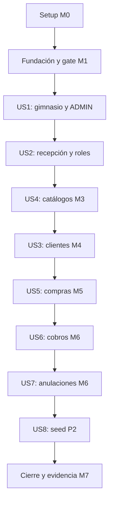

# Tasks: Núcleo de gestión multi-gimnasio

**Feature**: `001-gym-management-core` | **Created**: 2026-11-10
**Status**: Aprobada por el autor; implementación en curso. Las casillas registran el trabajo realizado.

**Input**: [Spec](spec.md), [plan aprobado](plan.md), [research](research.md),
[data model](data-model.md), [contrato REST](contracts/api.md),
[OpenAPI](contracts/openapi.yaml), [quickstart](quickstart.md) y
[plan de producto](../../docs/PLAN_DE_TRABAJO.md).

**Prerequisites**: Constitución 1.0.0, spec tras clarify y plan aprobados. Para
implementar hace falta aprobar este archivo. Trabajar en la rama de la spec;
main es producción y dev integración, sin merges ni push implícitos.

**Tests**: Obligatorios para reglas de negocio, aislamiento, permisos y contratos.
JUnit 5/Mockito y Testcontainers con PostgreSQL/Flyway reales. Cobertura ≥80% de
líneas de negocio comprobada por JaCoCo en verify/CI. No se afirma ningún resultado
por generar esta lista ni por una prueba upstream.

## Format: `[ID] [P?] [Story] Description`

- Cada tarea tiene ID único, rutas concretas y dependencias previas explícitas.
- [P] identifica independencia de archivos dentro de una ventana con dependencias
  satisfechas; no autoriza por sí solo delegación a agentes ni saltar hitos.
- Los tests se escriben antes del comportamiento. Puede definirse el mínimo contrato
  de tipos necesario para compilarlos; un error de compilación no sustituye observar
  el fallo del comportamiento esperado. Antes de cerrar cada hito la suite debe estar verde.
- Una tarea de tests no se considera implementación completa de la historia. Cada
  checkpoint exige ejecutar los tests después del código y revisar regresiones.

## Path Conventions

Rutas relativas a la raíz. Java principal en polygim-api/src/main/java/com/gymplatform/;
pruebas en polygim-api/src/test/java/com/gymplatform/. Migraciones dentro de
polygim-api/src/main/resources/db/migration/. No crear código bajo original/.
Los archivos nombrados abajo son previstos: se crearán en implement, no durante tasks.

## Prioridad y orden

Todas US1–US7 son P1; US8 es P2. Se ejecuta US4 antes de US3 porque el plan fija
catálogos M3 antes de clientes M4. US2 reutiliza autenticación/aislamiento de M1 y
completa la gestión de recepción en M2. La separación por historia conserva sus IDs
originales de la spec y permite verificarlas con fixtures independientes.

## Phase 1: Setup — M0

**Goal**: Entorno Java 21, build reproducible, configuración y errores básicos.

**Independent Test / Checkpoint**: Java 21 + Wrapper; PostgreSQL local inicia; build y tests básicos verdes. Todavía no existen casos de negocio tenant.

- [X] T001 Preparar Java 21 para este proyecto, generar Maven Wrapper 3.9.11 en `polygim-api/mvnw`, `polygim-api/mvnw.cmd` y `polygim-api/.mvn/wrapper/maven-wrapper.properties`, y documentar selección de JDK y verificaciones en `README.md`; no cambiar globalmente el JDK de otros proyectos. Referencia: Constitución I; research R1/R10.
- [X] T002 Crear `polygim-api/pom.xml` con parent Boot 3.5.16, dependencias y plugins del plan, Java release 21, Surefire/Failsafe y JaCoCo 0.8.16; integrar cobertura unitaria/IT y gate LINE ≥0.80 del conjunto de lógica de negocio, sin excluir reglas para alcanzar el umbral. Referencia: Constitución VI; research R1/R9. Depende de: T001.
- [X] T003 Crear `polygim-api/src/main/java/com/gymplatform/GymManagementApplication.java` y `polygim-api/src/main/resources/application.yml` con variables del quickstart, `ddl-auto=validate`, OSIV/L2/query cache desactivados y arranque cerrado sin credenciales de seguridad autogeneradas en logs. Referencia: Constitución I/V/VIII. Depende de: T002.
- [X] T004 [P] Definir `.env.example` con las variables de `quickstart.md`, valores no sensibles y secretos vacíos; comprobar exclusiones en `.gitignore` y documentar que no se usan credenciales del legacy. Referencia: Constitución V. Depende de: T002.
- [X] T005 Crear `compose.yaml` con PostgreSQL 17.11 fijado al digest de research R1, healthcheck, volumen local y variables de entorno; la base de tests será independiente de esta base. Referencia: research R1/R10. Depende de: T003, T004.
- [X] T006 [P] Escribir tests de errores/DTO estrictos en `polygim-api/src/test/java/com/gymplatform/controller/ProblemContractTest.java`: validación, JSON desconocido, métodos/formato no admitidos y 500 genérico con campos RFC 7807, sin secretos ni stack traces. Referencia: CR-005. Depende de: T002.
- [X] T007 Implementar `polygim-api/src/main/java/com/gymplatform/controller/error/ApiExceptionHandler.java` y `polygim-api/src/main/java/com/gymplatform/controller/error/ProblemFactory.java` para los contratos anteriores, con code y errores de campos y sin mensajes internos de SQL/constraints. Referencia: CR-005. Depende de: T003, T006.
- [X] T008 Crear `polygim-api/src/main/resources/db/migration/V1__baseline.sql` como migración inicial sin tablas de negocio y sin DDL manual/automático; mantener la configuración de Flyway en `polygim-api/src/main/resources/application.yml`. Referencia: Constitución VIII; data-model Migraciones. Depende de: T003.
- [X] T009 Crear `polygim-api/Dockerfile` multistage Java 21 y `polygim-api/.dockerignore`, integrar servicio app en `compose.yaml` sin secretos de build y sin copiar `original/`; el build de imagen no sustituye verify con Testcontainers. Referencia: plan M0. Depende de: T002, T003, T004, T005.
- [X] T010 Crear `.github/workflows/verify.yml` con Java 21, Wrapper, Docker disponible, `clean verify` y publicación de reportes sin secretos; ejecutar el cierre de M0 según `README.md` y registrar resultados reales en `docs/PLAN_DE_TRABAJO.md`. Referencia: Constitución VI; plan M0. Depende de: T005, T007, T008, T009.

## Phase 2: Foundational — M1, aislamiento primero

**Goal**: Demostrar identidad, scopes y persistencia tenant antes de catálogos, clientes o compras.

**Independent Test / Checkpoint**: TenantIsolationIT y SecurityIsolationIT verdes en PostgreSQL/Testcontainers con dos gimnasios; falta de tenant, sentinel, consultas por ID y relaciones ajenas rechazadas.

- [X] T011 Preparar soporte PostgreSQL/Testcontainers y fixtures de dos gimnasios en `polygim-api/src/test/java/com/gymplatform/integration/support/PostgresIntegrationSupport.java` y `polygim-api/src/test/java/com/gymplatform/integration/support/TenantFixtures.java`, usando Flyway real, credenciales ficticias generadas y scopes internos explícitos, sin desactivar guards de producción. Referencia: CR-001/CR-002/CR-006. Depende de: T010.
- [X] T012 [P] Escribir tests de contexto/resolver/guard en `polygim-api/src/test/java/com/gymplatform/tenant/TenantScopeTest.java`: contexto ausente, AUTH/PLATFORM no-root, tenant forzado, cambio de sesión y limpieza finally tras excepciones. Referencia: CR-001; research R2/R3. Depende de: T011.
- [X] T013 [P] Escribir `polygim-api/src/test/java/com/gymplatform/integration/TenantIsolationIT.java` con persist automático, find/list/count propios y ajenos, FK cruzadas de UsuarioGimnasio/configuración, cargas de relaciones y alternancia A/B con pool reutilizado; incluir la frontera de provisioning sin acceso a tenants existentes. Referencia: FR-006/FR-012; CR-001. Depende de: T011.
- [X] T014 [P] Escribir `polygim-api/src/test/java/com/gymplatform/integration/SecurityIsolationIT.java`: login sin tenant, 401/403/404 según contrato, JWT inválido/expirado, SUPERADMIN sin negocio y cuenta deshabilitada con token vigente; los cambios de fixture no sustituyen la prueba posterior del endpoint de deshabilitación. Referencia: FR-002/FR-003/FR-007; CR-002/CR-005. Depende de: T011.
- [X] T015 [P] Escribir unitarias de identidad/tokens en `polygim-api/src/test/java/com/gymplatform/service/IdentityServiceTest.java` y `polygim-api/src/test/java/com/gymplatform/security/JwtTokenServiceTest.java`: normalización/email global, política BCrypt sin truncar, issuer/audience/exp/algoritmo y estado actual de cuenta. Referencia: FR-002; research R5. Depende de: T011.
- [X] T016 [P] Escribir `polygim-api/src/test/java/com/gymplatform/integration/SchemaMigrationIT.java` para vacío y V1→V2, constraints email/rol/gimnasio y FK compuesta de usuario; ampliar el mismo test al introducir cada migración posterior, preservando dos gimnasios tras crear el esquema tenant. Referencia: Constitución VIII; data-model. Depende de: T011.
- [X] T017 Crear `polygim-api/src/main/resources/db/migration/V2__tenant_identity.sql` y entidades `polygim-api/src/main/java/com/gymplatform/model/Gimnasio.java`, `polygim-api/src/main/java/com/gymplatform/model/CuentaAcceso.java`, `polygim-api/src/main/java/com/gymplatform/model/UsuarioGimnasio.java` y `polygim-api/src/main/java/com/gymplatform/model/ConfiguracionGimnasio.java` con las restricciones de data-model, @TenantId solo en entidades tenant y sentinel reservado fuera de gimnasio. Referencia: FR-003/FR-012; CR-001. Depende de: T012, T013, T014, T015, T016.
- [X] T018 Crear persistencia encapsulada en `polygim-api/src/main/java/com/gymplatform/repository/TenantRepository.java`, `polygim-api/src/main/java/com/gymplatform/repository/JpaTenantRepository.java` y `polygim-api/src/main/java/com/gymplatform/repository/identity/IdentityRepository.java`: altas por persist explícito, lecturas JPA filtradas y métodos globales privados acotados a identidad; no exponer merge/save de DTOs ni borrados por proxy. Referencia: research R2/R3/R8. Depende de: T017.
- [X] T019 Implementar `polygim-api/src/main/java/com/gymplatform/tenant/TenantContext.java`, `polygim-api/src/main/java/com/gymplatform/tenant/GymTenantIdentifierResolver.java` y `polygim-api/src/main/java/com/gymplatform/tenant/TenantGuard.java`; registro Hibernate en `polygim-api/src/main/java/com/gymplatform/config/PersistenceConfig.java`, isRoot=false, guard antes de transacción y sin propagación implícita entre hilos. Referencia: FR-006; CR-001. Depende de: T017, T018, T012.
- [X] T020 Implementar `polygim-api/src/main/java/com/gymplatform/tenant/IdentityScopeExecutor.java` y `polygim-api/src/main/java/com/gymplatform/tenant/GymProvisioningExecutor.java`: cerrar AUTH antes de TENANT y abrir provisioning con UUID nuevo antes de la transacción; autorización interna limitada a crear ese gimnasio/vínculos/configuración, sin bypass general ni acceso a existentes. Referencia: research R3/R4. Depende de: T018, T019, T013.
- [X] T021 Implementar `polygim-api/src/main/java/com/gymplatform/service/IdentityService.java` y `polygim-api/src/main/java/com/gymplatform/security/CurrentAccountPrincipal.java` con lookup global corto, email único incluso deshabilitados, PasswordEncoder y relectura de cuenta/rol/gimnasio por solicitud sin caché; no serializar password_hash. Referencia: FR-002/FR-003; CR-002. Depende de: T020, T015.
- [X] T022 Implementar bootstrap opt-in por entorno en `polygim-api/src/main/java/com/gymplatform/config/SuperadminBootstrap.java`: crear SUPERADMIN solo si no existe, sin sobrescribir hashes, reactivar cuentas ni registrar secretos; fallar de forma clara si la configuración requerida es parcial. Referencia: research R10; Constitución V. Depende de: T021.
- [X] T023 Implementar `polygim-api/src/main/java/com/gymplatform/security/JwtTokenService.java`, `polygim-api/src/main/java/com/gymplatform/security/CurrentAccountAuthenticationConverter.java`, `polygim-api/src/main/java/com/gymplatform/security/SecurityConfig.java` y `polygim-api/src/main/java/com/gymplatform/security/TenantRequestFilter.java` para HS256, clave de entorno, 15 minutos iniciales y limpieza de contexto; usar la cuenta actual, no claims históricos de permisos. Referencia: FR-002/FR-006; research R5. Depende de: T021, T019, T015.
- [X] T024 Crear `polygim-api/src/main/java/com/gymplatform/controller/AuthController.java` y `polygim-api/src/main/java/com/gymplatform/controller/dto/AuthDtos.java` para login y me; conectar handlers `polygim-api/src/main/java/com/gymplatform/security/ProblemAuthenticationEntryPoint.java` y `polygim-api/src/main/java/com/gymplatform/security/ProblemAccessDeniedHandler.java` con ProblemFactory y comprobar que no haya usuario/password automático de Spring. Referencia: FR-002/FR-007; CR-005. Depende de: T023, T022, T014.
- [X] T025 Definir infraestructura común de Clock y paginación en `polygim-api/src/main/java/com/gymplatform/config/TimeConfig.java` y `polygim-api/src/main/java/com/gymplatform/controller/dto/PageResponse.java`; fechas de calendario uniformes por APP_TIME_ZONE y páginas 20/100 estables, sin parámetros que puedan cambiar tenant. Referencia: research R6; contracts reglas comunes. Depende de: T019, T024.
- [X] T026 Ejecutar gate M1 con `polygim-api/pom.xml` (`TenantIsolationIT`, `SecurityIsolationIT`, migraciones y unitarias), revisar todas las vías de consulta contra research R2 y registrar evidencia real en `docs/PLAN_DE_TRABAJO.md`; bloquear M2–M7 si hay fallos, sin saltar tests ni añadir root/native SQL. Referencia: CR-001/CR-002/CR-006. Depende de: T013, T014, T016, T017, T018, T019, T020, T021, T022, T023, T024, T025.

## Phase 3: US1 — Habilitar gimnasio y primer ADMIN (P1, M2)

**Goal**: Aprovisionar gimnasio/configuración/ADMIN de forma atómica y permitir consultar solo metadatos de plataforma.

**Independent Test / Checkpoint**: Con SUPERADMIN y fixtures independientes: alta completa o rollback, email duplicado genérico, usuarios de gimnasio denegados y ningún acceso global al negocio.

### Tests for US1 — obligatorios

- [ ] T027 [P] [US1] Escribir `polygim-api/src/test/java/com/gymplatform/service/GimnasioServiceTest.java` para creación atómica, máximo inicial de entorno, normalización y fallo en cada parte; usar el ejecutor de aprovisionamiento validado en M1. Referencia: FR-001; US1. Depende de: T026.
- [ ] T028 [P] [US1] Escribir `polygim-api/src/test/java/com/gymplatform/integration/GimnasioApiIT.java` para los tres endpoints plataforma, rollback real sin huérfanos, colisión de email, 403 de ADMIN/RECEPCION y SUPERADMIN sin acceso a recursos del gimnasio. Referencia: FR-001/FR-003/FR-007; US1. Depende de: T026.

### Implementation for US1

- [ ] T029 [US1] Implementar `polygim-api/src/main/java/com/gymplatform/repository/GimnasioRepository.java` con persist/lectura/paginación de metadatos globales y `polygim-api/src/main/java/com/gymplatform/service/GimnasioService.java` que crea gimnasio, CuentaAcceso, UsuarioGimnasio y configuración en una transacción del ejecutor; no habilitar consultas globales de negocio. Referencia: FR-001; research R4. Depende de: T027, T028, T026.
- [ ] T030 [US1] Crear `polygim-api/src/main/java/com/gymplatform/controller/PlataformaGimnasioController.java` y `polygim-api/src/main/java/com/gymplatform/controller/dto/GimnasioDtos.java` para POST/GET colección y GET por ID con logoUrl/color y administradorInicial; respuestas no contienen password/hash. Referencia: FR-001/FR-003; contracts plataforma. Depende de: T029.
- [ ] T031 [US1] Ejecutar pruebas de US1 y regresión de M1 mediante `polygim-api/pom.xml`, contrastar respuestas con `specs/001-gym-management-core/contracts/openapi.yaml` y registrar avance parcial M2 en `docs/PLAN_DE_TRABAJO.md`. Referencia: US1; SC-002. Depende de: T030.

## Phase 4: US2 — Operar con roles y recepción (P1, completar M2)

**Goal**: Completar la administración de recepción y demostrar autorización con el acceso construido en M1.

**Independent Test / Checkpoint**: ADMIN crea/deshabilita recepción propia; cuenta deshabilitada pierde acceso con JWT vigente; cuentas/IDs ajenos no se exponen y recepción no administra/configura.

### Tests for US2 — obligatorios

- [ ] T032 [P] [US2] Escribir `polygim-api/src/test/java/com/gymplatform/service/ReceptionServiceTest.java` para alta/disabled, vínculo tenant primero, unicidad global del email y rol fijo RECEPCION, sin reactivación ni liberación de email. Referencia: FR-002/FR-004/FR-005. Depende de: T031.
- [ ] T033 [P] [US2] Escribir `polygim-api/src/test/java/com/gymplatform/integration/ReceptionApiIT.java` para alta y PUT de deshabilitación repetido, ID ajeno/no RECEPCION→404, llamadas de RECEPCION→403 y acceso con JWT después de deshabilitar→401. Referencia: FR-004/FR-007; US2. Depende de: T031.

### Implementation for US2

- [ ] T034 [US2] Implementar `polygim-api/src/main/java/com/gymplatform/repository/UsuarioGimnasioRepository.java` y `polygim-api/src/main/java/com/gymplatform/service/ReceptionService.java`: resolver usuario propio por @TenantId antes de tocar la identidad global, crear cuenta/vínculo atómicamente y deshabilitar sin borrar. Referencia: FR-004/FR-006/FR-012. Depende de: T032, T033.
- [ ] T035 [US2] Crear `polygim-api/src/main/java/com/gymplatform/controller/ReceptionController.java` y `polygim-api/src/main/java/com/gymplatform/controller/dto/ReceptionDtos.java` para POST usuarios-recepcion y PUT deshabilitacion sin campos rol/tenant aceptados; respetar respuestas genéricas y la matriz del contrato. Referencia: FR-004/FR-005; contracts recepción. Depende de: T034.
- [ ] T036 [US2] Ampliar `polygim-api/src/test/java/com/gymplatform/integration/SecurityIsolationIT.java` con los endpoints reales de US1/US2, manipulación de tenant/rol en DTOs, limpieza entre solicitudes y precedencia 401/403/404 sin revelar existencia ajena. Referencia: FR-002–FR-007; CR-002/CR-005. Depende de: T035.
- [ ] T037 [US2] Cerrar M2 ejecutando `polygim-api/pom.xml` y registrar en `docs/PLAN_DE_TRABAJO.md` que alta de gimnasio y recepción funcionan sin alterar main/dev; no avanzar con regresiones de M1. Referencia: SC-001/SC-002. Depende de: T036.

## Phase 5: US4 — Configurar la oferta (P1, M3)

**Goal**: Catálogos propios, membresías con precio/duración explícitos y cantidad máxima configurable.

**Independent Test / Checkpoint**: Dos gimnasios configuran ofertas diferentes; ADMIN modifica catálogos/configuración, RECEPCION solo consulta; precio cero/negativo y referencias ajenas se rechazan.

### Tests for US4 — obligatorios

- [ ] T038 [P] [US4] Escribir `polygim-api/src/test/java/com/gymplatform/service/CatalogoServiceTest.java` y `polygim-api/src/test/java/com/gymplatform/service/MembresiaServiceTest.java` para nombres normalizados, precios >0, escala exacta/desborde, duración/unidad, disciplina fija al crear y máximo de compra positivo. Referencia: FR-010/FR-011; CR-003/CR-004. Depende de: T037.
- [ ] T039 [P] [US4] Escribir `polygim-api/src/test/java/com/gymplatform/integration/CatalogoApiIT.java` para los 18 contratos de catálogos/configuración, aislamiento de IDs/filtros/count/páginas, email fuera de estos DTOs, duplicados de nombres, conflictos y permisos ADMIN/RECEPCION. Referencia: FR-010–FR-012; US4. Depende de: T037.

### Implementation for US4

- [ ] T040 [US4] Crear `polygim-api/src/main/resources/db/migration/V3__tenant_catalogs.sql` con canal_llegada/localidad/disciplina/membresia, índices de nombres normalizados y FK compuestas; extender `polygim-api/src/test/java/com/gymplatform/integration/SchemaMigrationIT.java` para V2→V3 y constraint precio/duración. Referencia: FR-010/FR-012; Constitución VIII. Depende de: T038, T039.
- [ ] T041 [US4] Crear `polygim-api/src/main/java/com/gymplatform/model/CanalLlegada.java`, `polygim-api/src/main/java/com/gymplatform/model/Localidad.java`, `polygim-api/src/main/java/com/gymplatform/model/Disciplina.java` y `polygim-api/src/main/java/com/gymplatform/model/Membresia.java` con @TenantId/version y unidad explícita, sin nombres de disciplinas fijados en código. Referencia: FR-010/FR-012; CR-003. Depende de: T040.
- [ ] T042 [US4] Implementar `polygim-api/src/main/java/com/gymplatform/repository/CatalogoRepository.java` y `polygim-api/src/main/java/com/gymplatform/repository/MembresiaRepository.java` con consultas JPQL filtradas, filtro por disciplina validado y páginas estables; actualizar entidades managed sin merge. Referencia: FR-010/FR-012; research R2. Depende de: T041.
- [ ] T043 [US4] Implementar `polygim-api/src/main/java/com/gymplatform/service/CatalogoService.java`, `polygim-api/src/main/java/com/gymplatform/service/MembresiaService.java` y `polygim-api/src/main/java/com/gymplatform/service/ConfiguracionService.java` para reglas y transacciones; resolver referencias propias antes de escribir y traducir duplicados/versiones a 409 sin SQL interno. Referencia: FR-010/FR-011; US4. Depende de: T038, T042.
- [ ] T044 [US4] Crear `polygim-api/src/main/java/com/gymplatform/controller/dto/MoneyCodec.java` y `polygim-api/src/main/java/com/gymplatform/controller/dto/CatalogoDtos.java` para dinero string canónico con dos posiciones y datos de catálogos; validar formato sin aplicar reglas de negocio en controladores. Referencia: CR-004; contracts dinero. Depende de: T043.
- [ ] T045 [US4] Crear `polygim-api/src/main/java/com/gymplatform/controller/CatalogoController.java`, `polygim-api/src/main/java/com/gymplatform/controller/MembresiaController.java` y `polygim-api/src/main/java/com/gymplatform/controller/ConfiguracionController.java` con los 18 contratos aprobados, delegación a servicios y autorización de escritura solo ADMIN. Referencia: FR-010/FR-011; contracts catálogos. Depende de: T044, T039.
- [ ] T046 [US4] Ejecutar tests US4, migraciones y regresión de M1/M2 con `polygim-api/pom.xml`; registrar M3 en `docs/PLAN_DE_TRABAJO.md`, incluida configuración diferente entre gimnasios sin cambios de código. Referencia: SC-007. Depende de: T045.

## Phase 6: US3 — Registrar y mantener clientes (P1, M4)

**Goal**: Identificar clientes por ID propio y DNI único por gimnasio, con datos de contacto opcionales.

**Independent Test / Checkpoint**: Alta solo con DNI/nombre/apellido, edición sin cambiar identidad, DNI compartido entre gimnasios válido y duplicado propio rechazado; asociaciones opcionales ajenas denegadas.

### Tests for US3 — obligatorios

- [ ] T047 [P] [US3] Escribir `polygim-api/src/test/java/com/gymplatform/service/ClienteServiceTest.java` para DNI 7/8 dígitos conservado como texto, nombres no vacíos, opcionales ausentes y edición con asociaciones propias sin cambiar ID/fecha de ingreso/tenant. Referencia: FR-008/FR-009; US3. Depende de: T046.
- [ ] T048 [P] [US3] Escribir `polygim-api/src/test/java/com/gymplatform/integration/ClienteApiIT.java` para POST/PUT/GET/listado y filtro DNI, duplicación en alta/edición propia vs otro tenant, catálogos opcionales ajenos, paginación y errores RFC 7807. Referencia: FR-008/FR-009/FR-012; SC-003. Depende de: T046.

### Implementation for US3

- [ ] T049 [US3] Crear `polygim-api/src/main/resources/db/migration/V4__tenant_clients.sql` con dirección embebida, DNI tenant único y FKs opcionales compuestas; ampliar `polygim-api/src/test/java/com/gymplatform/integration/SchemaMigrationIT.java` para V3→V4 sin DDL fuera de Flyway. Referencia: FR-009/FR-012. Depende de: T047, T048.
- [ ] T050 [US3] Crear `polygim-api/src/main/java/com/gymplatform/model/Cliente.java`, `polygim-api/src/main/java/com/gymplatform/model/Direccion.java` y `polygim-api/src/main/java/com/gymplatform/repository/ClienteRepository.java` con @TenantId, @Version, consultas/listados propios y datos opcionales independientes; no usar DNI como PK. Referencia: FR-008/FR-009. Depende de: T049.
- [ ] T051 [US3] Implementar `polygim-api/src/main/java/com/gymplatform/service/ClienteService.java` y `polygim-api/src/main/java/com/gymplatform/controller/dto/ClienteDtos.java`: alta mínima y reemplazo completo de editables, limpieza de opcionales omitidos en PUT y validación de canales/localidades propios sin inventar valores. Referencia: FR-008/FR-012. Depende de: T050, T047.
- [ ] T052 [US3] Crear `polygim-api/src/main/java/com/gymplatform/controller/ClienteController.java` con los cuatro endpoints, filtro DNI exacto, autoridad ADMIN/RECEPCION y actor/contexto de servidor; no exponer DELETE. Referencia: FR-008; contracts clientes. Depende de: T051, T048.
- [ ] T053 [US3] Ejecutar pruebas US3 y regresiones anteriores con `polygim-api/pom.xml`; registrar M4 y evidencia de DNI por tenant en `docs/PLAN_DE_TRABAJO.md`. Referencia: SC-001/SC-003. Depende de: T052.

## Phase 7: US5 — Comprar y renovar (P1, M5)

**Goal**: Pedido inmutable de una membresía con snapshots, total exacto y renovación sin bifurcaciones.

**Independent Test / Checkpoint**: Crear compra y renovar con Clock fijo; un detalle, precio congelado, calendario correcto y dos renovaciones del mismo antecedente producen un único sucesor.

### Tests for US5 — obligatorios

- [ ] T054 [P] [US5] Escribir `polygim-api/src/test/java/com/gymplatform/service/PedidoPolicyTest.java` para total/escala/overflow, cantidades/máximo, snapshots, fecha pasada/futura, días/semanas/meses, cierre de mes/bisiestos, vigencia inclusiva y renovación vigente/vencida. Referencia: FR-013–FR-020; CR-004. Depende de: T053.
- [ ] T055 [P] [US5] Escribir `polygim-api/src/test/java/com/gymplatform/integration/PedidoApiIT.java` para los tres endpoints, asociaciones ajenas, DTO estricto sin total/precio/detalles múltiples, historial tras editar cliente/catálogo y ausencia de edición/borrado de pedidos. Referencia: FR-013–FR-020/FR-028/FR-029. Depende de: T053.
- [ ] T056 [P] [US5] Escribir `polygim-api/src/test/java/com/gymplatform/integration/RenovacionConcurrencyIT.java` con dos conexiones/transacciones y sincronización determinista: mismo antecedente→un 201/un 409, ciclos/fecha previa inválidos, misma membresía/cliente y conservación de la cadena. Referencia: FR-018/FR-030; US5. Depende de: T053.

### Implementation for US5

- [ ] T057 [US5] Crear `polygim-api/src/main/resources/db/migration/V5__tenant_orders.sql` con detalle embebido NOT NULL, snapshots, FKs tenant y UNIQUE de sucesor; extender `polygim-api/src/test/java/com/gymplatform/integration/SchemaMigrationIT.java` para V4→V5 y restricciones del agregado. Referencia: FR-013/FR-015/FR-018. Depende de: T054, T055, T056.
- [ ] T058 [US5] Crear `polygim-api/src/main/java/com/gymplatform/model/Pedido.java`, `polygim-api/src/main/java/com/gymplatform/model/DetallePedido.java` y `polygim-api/src/main/java/com/gymplatform/repository/PedidoRepository.java` con altas por persist, pedido comercial inmutable y lookup PESSIMISTIC_WRITE del antecedente; sin tabla de múltiples detalles. Referencia: FR-013/FR-015/FR-018/FR-028. Depende de: T057.
- [ ] T059 [US5] Implementar `polygim-api/src/main/java/com/gymplatform/service/policy/PedidoPolicy.java` y `polygim-api/src/main/java/com/gymplatform/service/policy/VigenciaPolicy.java` con BigDecimal exacto, snapshots y Clock fijado una vez por operación, sin interpretar nombres de membresías. Referencia: FR-014/FR-017–FR-020; CR-004. Depende de: T054, T058.
- [ ] T060 [US5] Implementar `polygim-api/src/main/java/com/gymplatform/service/PedidoService.java`: resolver cliente/membresía/configuración propios, usar precio actual al registrar pasado y crear compra/sucesor en transacción con lock y validación de antecedente; traducir sucesor duplicado a 409. Referencia: FR-013–FR-018/FR-030. Depende de: T059, T056.
- [ ] T061 [US5] Crear `polygim-api/src/main/java/com/gymplatform/service/PedidoQueryService.java`, `polygim-api/src/main/java/com/gymplatform/controller/PedidoController.java` y `polygim-api/src/main/java/com/gymplatform/controller/dto/PedidoDtos.java` para altas y lecturas paginadas; en este incremento sin pagos los estados iniciales se derivan del total positivo, y US6 incorporará la agregación real antes del cierre de la feature. Referencia: FR-020/FR-021/FR-029. Depende de: T060, T055.
- [ ] T062 [US5] Ejecutar pruebas US5 y carrera real de renovación mediante `polygim-api/pom.xml`; registrar M5 en `docs/PLAN_DE_TRABAJO.md`. La consulta final de deuda/historial queda condicionada a completar US6/US7; no dejar proveedores ficticios de saldo en la implementación final. Referencia: SC-004/SC-006. Depende de: T061.

## Phase 8: US6 — Registrar cobros (P1, M6)

**Goal**: Pagos parciales/exactos/excedidos, deuda y estado calculados bajo lock de pedido.

**Independent Test / Checkpoint**: Compra 200.50 → pago 50.25 → recibido 200.00 aplica 150.25 y devuelve 49.75; no cambia vencimiento y cobros concurrentes no exceden el total.

### Tests for US6 — obligatorios

- [ ] T063 [P] [US6] Escribir `polygim-api/src/test/java/com/gymplatform/service/PagoPolicyTest.java` y `polygim-api/src/test/java/com/gymplatform/service/PagoServiceTest.java` para exacto/parcial/exceso, recibido/aplicado positivos, deuda cero, suma sin anulados y separación entre pago y vigencia. Referencia: FR-021–FR-025; CR-004. Depende de: T062.
- [ ] T064 [P] [US6] Escribir `polygim-api/src/test/java/com/gymplatform/integration/PagoApiIT.java` para POST/listado de pagos por pedido y GET pago, importe string, historial, ID ajeno→404, roles, errores y snapshots temporales inalterados. Referencia: FR-021–FR-025/FR-029. Depende de: T062.
- [ ] T065 [P] [US6] Escribir `polygim-api/src/test/java/com/gymplatform/integration/PagoConcurrencyIT.java` con transacciones/conexiones separadas y barreras: cobros simultáneos no sobreaplican, saldo nunca negativo y fallos revierten pago/estado completo; sin sleeps como prueba de carrera. Referencia: FR-030. Depende de: T062.

### Implementation for US6

- [ ] T066 [US6] Crear `polygim-api/src/main/resources/db/migration/V6__tenant_payments.sql`, `polygim-api/src/main/java/com/gymplatform/model/Pago.java` y `polygim-api/src/main/java/com/gymplatform/model/AnulacionPago.java` como movimientos inmutables con FKs tenant/actor y anulación única. La entidad de anulación se introduce aquí porque la deuda ya depende de ella; US7 habilitará su escritura por API. Referencia: FR-021/FR-026/FR-030; data-model. Depende de: T063, T064, T065.
- [ ] T067 [US6] Implementar `polygim-api/src/main/java/com/gymplatform/repository/PagoRepository.java` y `polygim-api/src/main/java/com/gymplatform/service/policy/PagoPolicy.java`: sumar pagos aplicados sin anulación, decidir aplicado/vuelto con exactitud y devolver estado calculado, sin flags duplicados ni JDBC/native. Referencia: FR-021–FR-025. Depende de: T066, T063.
- [ ] T068 [US6] Implementar `polygim-api/src/main/java/com/gymplatform/service/PagoService.java` y actualizar `polygim-api/src/main/java/com/gymplatform/service/PedidoQueryService.java` para bloquear pedido antes de leer saldo, persistir pago/actor y devolver deuda/estado reales en transacción; reemplazar por completo el estado inicial sin pagos de M5 y evitar N+1 en listados. Referencia: FR-021–FR-025/FR-029/FR-030. Depende de: T067, T065.
- [ ] T069 [US6] Crear `polygim-api/src/main/java/com/gymplatform/controller/PagoController.java` y `polygim-api/src/main/java/com/gymplatform/controller/dto/PagoDtos.java` para los tres contratos de cobro/historial, sin almacenar vuelto como pago; documentar que POST perdido no se reintenta automáticamente. Referencia: FR-023–FR-025/FR-029; contracts pagos. Depende de: T068, T064.
- [ ] T070 [US6] Ampliar `polygim-api/src/test/java/com/gymplatform/integration/SchemaMigrationIT.java` para V5→V6 e integridad de actores y revisar `polygim-api/src/test/java/com/gymplatform/integration/PedidoApiIT.java` con pagos reales, edición comercial rechazada y estados calculados de compras vigentes/vencidas. Referencia: FR-012/FR-022/FR-028; Constitución VIII. Depende de: T069.
- [ ] T071 [US6] Ejecutar pruebas US6 y regresiones mediante `polygim-api/pom.xml`; registrar avance parcial M6 en `docs/PLAN_DE_TRABAJO.md` con resultados reales del circuito monetario y concurrencia. Referencia: SC-005/SC-006. Depende de: T070.

## Phase 9: US7 — Anular preservando historial (P1, completar M6)

**Goal**: Solo ADMIN anula un pago y conserva movimiento/actor/fecha sin duplicar efectos.

**Independent Test / Checkpoint**: Anular el pago aplicado 150.25 reabre deuda 150.25; repetir devuelve la misma evidencia; recepción/otro gimnasio no modifican movimientos ni vigencia.

### Tests for US7 — obligatorios

- [ ] T072 [P] [US7] Escribir `polygim-api/src/test/java/com/gymplatform/service/AnulacionServiceTest.java` para permiso ADMIN, deuda recalculada, evidencia inmutable, repetición idempotente y fechas/vigencia sin cambios. Referencia: FR-026/FR-027/FR-022. Depende de: T071.
- [ ] T073 [P] [US7] Escribir `polygim-api/src/test/java/com/gymplatform/integration/AnulacionApiIT.java` para PUT sin body, 201 inicial/200 repetido con mismo registro, 403 de recepción, 404 ajeno, actor de servidor y pedido no editable aun con todos sus pagos anulados. Referencia: FR-026–FR-029. Depende de: T071.

### Implementation for US7

- [ ] T074 [US7] Implementar `polygim-api/src/main/java/com/gymplatform/repository/AnulacionRepository.java` y `polygim-api/src/main/java/com/gymplatform/service/AnulacionService.java`: cargar pago propio, bloquear primero pedido padre como en el cobro, crear como máximo una evidencia y recalcular saldo sin borrar ni reactivar. Referencia: FR-026/FR-027/FR-030. Depende de: T072, T073.
- [ ] T075 [US7] Crear `polygim-api/src/main/java/com/gymplatform/controller/AnulacionController.java` y `polygim-api/src/main/java/com/gymplatform/controller/dto/AnulacionDtos.java`, y extender `polygim-api/src/main/java/com/gymplatform/controller/dto/PagoDtos.java` con estado/evidencia de anulación sin exponer datos de otros usuarios. Referencia: FR-026/FR-029; contracts anulaciones. Depende de: T074.
- [ ] T076 [US7] Ampliar `polygim-api/src/test/java/com/gymplatform/integration/PagoConcurrencyIT.java` con dos anulaciones simultáneas y anulación/cobro sobre el mismo pedido; verificar lock común, una evidencia y saldo consistente sin restaurar flags manuales. Referencia: FR-027/FR-030. Depende de: T075.
- [ ] T077 [US7] Cerrar M6 con `polygim-api/pom.xml`, incluyendo el circuito completo de `specs/001-gym-management-core/quickstart.md`, y registrar resultados en `docs/PLAN_DE_TRABAJO.md` sin afirmar cobertura no medida. Referencia: SC-005/SC-006. Depende de: T076.

## Phase 10: US8 — Datos iniciales ficticios (P2, M7)

**Goal**: Preparar una demostración reproducible con el primer gimnasio como datos y sin condicionar el código.

**Independent Test / Checkpoint**: Seed opt-in crea oferta de ejemplo y ADMIN desde entorno; otro gimnasio puede tener oferta distinta; reiniciar no duplica ni sobrescribe compras, pagos o credenciales.

### Tests for US8 — obligatorios

- [ ] T078 [P] [US8] Escribir `polygim-api/src/test/java/com/gymplatform/seed/DemoSeedLoaderTest.java` y `polygim-api/src/test/java/com/gymplatform/integration/DemoSeedIT.java` con fixtures genéricas para opt-in, ids estables, credenciales desde entorno, idempotencia, rollback y no sobrescritura; los nombres de tests no mencionan al primer gimnasio. Referencia: FR-031; CR-003; US8. Depende de: T077.

### Implementation for US8

- [ ] T079 [P] [US8] Definir `polygim-api/src/main/resources/seed/gimnasios-demo.yml` con el tenant inicial acordado, las tres disciplinas y una membresía ficticia positiva por disciplina, incluidos precio 100.25/duración 2 SEMANAS del quickstart; canales y configuración son datos, sin passwords ni tokens. Referencia: FR-031; research R10. Depende de: T077.
- [ ] T080 [US8] Implementar `polygim-api/src/main/java/com/gymplatform/seed/DemoSeedLoader.java` y `polygim-api/src/main/java/com/gymplatform/seed/SeedDefinition.java` como cargador genérico del formato, usando servicios/scopes autorizados y claves estables; no ramificar por nombres ni añadir bypass de tenant. Referencia: FR-031; CR-001/CR-003. Depende de: T078, T079.
- [ ] T081 [US8] Integrar activación demo/SEED_DEMO_ENABLED y credenciales por entorno en `polygim-api/src/main/resources/application.yml`, `polygim-api/src/main/java/com/gymplatform/seed/DemoSeedConfiguration.java` y `.env.example`, preservando bootstrap existente y sin cambiar hashes en reinicios. Referencia: research R10; Constitución V. Depende de: T080.
- [ ] T082 [US8] Ejecutar validación del seed y segundo gimnasio con `polygim-api/pom.xml`, actualizar instrucciones reales de demostración en `README.md` y registrar avance parcial M7 en `docs/PLAN_DE_TRABAJO.md`. Referencia: SC-007/SC-008. Depende de: T081.

## Phase 11: Polish & Cross-Cutting Concerns — Cierre M7

**Goal**: Cerrar la feature con evidencia real de contratos, aislamiento, cobertura y operación local.

**Independent Test / Checkpoint**: verify/CI verdes, 36 operaciones coherentes con OpenAPI, 80% de líneas de negocio medido y quickstart reproducido; sin funciones de otras features.

- [ ] T083 Configurar springdoc y perfil local-docs en `polygim-api/src/main/java/com/gymplatform/config/OpenApiConfig.java` y `polygim-api/src/main/resources/application.yml`; mantener API docs/UI solo en perfil local según plan y descripciones fieles a DTOs/errores. Referencia: FR-032; plan M7. Depende de: T082.
- [ ] T084 Escribir `polygim-api/src/test/java/com/gymplatform/integration/OpenApiContractIT.java` para contrastar inventario de 36 operationId, request/response schemas y errores de `specs/001-gym-management-core/contracts/openapi.yaml` con /v3/api-docs, sin exigir igualdad de ejemplos o metadatos generados. Referencia: FR-032; CR-005. Depende de: T083.
- [ ] T085 Ejecutar la matriz completa de dos tenants/roles en `polygim-api/src/test/java/com/gymplatform/integration/FeatureAcceptanceIT.java`: cuentas, catálogos, clientes, pedidos, pagos/anulaciones, filtros y counts, 401/403/404 y DTOs forzados; cubrir SC-001–SC-008 sin habilitar endpoints de prueba en producción. Referencia: FR-001–FR-032; CR-001/CR-002. Depende de: T084.
- [ ] T086 Revisar selección real de clases y ejecutar `clean verify` en `polygim-api/pom.xml`, revisar reportes unitarios/Failsafe/JaCoCo, actualización Flyway y CI en `.github/workflows/verify.yml`; comprobar que bajar del 80% bloquea y que no se ha omitido lógica del denominador. Referencia: CR-006; Constitución VI/VIII. Depende de: T085.
- [ ] T087 Revisar `polygim-api/src/main/`, `.env.example`, `compose.yaml` y `polygim-api/Dockerfile` contra Constitución V y research R2/R10: ausencia de secretos, nombres del primer tenant fuera de datos, SQL nativo/bulk/merge de negocio, root y accesos globales no autorizados. Referencia: Constitución II/III/V. Depende de: T086.
- [ ] T088 Reproducir y ajustar solo instrucciones a la implementación aprobada en `specs/001-gym-management-core/quickstart.md` y `README.md`; probar arranque, compra/cobro/anulación y seed repetido, sin desplegar demo pública ni borrar volúmenes de datos conservables. Referencia: SC-008; plan M7. Depende de: T087.
- [ ] T089 Registrar conteo real de tests, cobertura, resultados del gate y latencias observadas sin prometer SLA en `docs/PLAN_DE_TRABAJO.md`; comprobar criterios de hecho y conservar pendientes reales como pendientes, sin mezclar integración a dev/main con el cierre técnico. Referencia: plan M7; sección 8 del producto. Depende de: T088.

## Dependencies & Execution Order

- No adelantar entidades/casos de negocio de M2–M7 para aparentar pasar M1.
- Cada migración se introduce antes del código/pruebas que necesitan esas tablas;
  SchemaMigrationIT se amplía al subir cada versión, sin reescribir las anteriores.
- V6 y AnulacionPago se introducen en US6 porque el saldo excluye anulados; US7 agrega
  su escritura autorizada. No se exige una tabla futura antes de su migración.
- Las lecturas de US5 tienen estado inicial sin pagos por construcción del incremento.
  US6 debe reemplazarlo por la agregación real, y el cierre ejecuta ambos conjuntos de
  regresiones. No se permite un stub de deuda en la feature final.
- Las pruebas entre historias usan fixtures independientes; esto no elimina la
  dependencia de sus entidades, migraciones e infraestructura compartida.
- Cambios en pom.xml, application.yml, SchemaMigrationIT, PagoDtos o plan de producto
  se hacen secuencialmente cuando coinciden archivos, aunque otras tareas sean [P].

## Parallel Opportunities by User Story

- **US1**: T027, T028 pueden escribirse en paralelo después del checkpoint previo; cada una tiene archivos propios.
- **US2**: T032, T033 pueden escribirse en paralelo después del checkpoint previo; cada una tiene archivos propios.
- **US4**: T038, T039 pueden escribirse en paralelo después del checkpoint previo; cada una tiene archivos propios.
- **US3**: T047, T048 pueden escribirse en paralelo después del checkpoint previo; cada una tiene archivos propios.
- **US5**: T054, T055, T056 pueden escribirse en paralelo después del checkpoint previo; cada una tiene archivos propios.
- **US6**: T063, T064, T065 pueden escribirse en paralelo después del checkpoint previo; cada una tiene archivos propios.
- **US7**: T072, T073 pueden escribirse en paralelo después del checkpoint previo; cada una tiene archivos propios.
- **US8**: T078 y T079 pueden escribirse en paralelo después de US7: tests genéricos y archivo YAML de datos afectan archivos distintos; el cargador espera ambos.

Los grupos anteriores identifican oportunidades, no obligan a usarlas. No se ejecutan
historias completas en paralelo mientras dependen del checkpoint anterior.

## Implementation Strategy

- Primer incremento técnico demostrable: M0 + gate M1 + US1/US2. Permite aprovisionar
  dos gimnasios y operar acceso/recepción aislados, pero todavía no es paridad de cobros.
- MVP de negocio: completar US4, US3, US5, US6 y US7 sobre ese núcleo; incluye venta,
  pagos parciales y anulaciones. US8 y el cierre completan los requisitos de la feature.
- Ejecutar un hito por vez, con tests verdes y commit convencional al terminar un
  cambio coherente. Detenerse ante fallos del gate o una contradicción material.
- No agregar reservas, próximos vencimientos, pantallas, importación, cobros online,
  recuperación pública de cuentas, refresh tokens ni despliegue público.
- No cambiar versiones o arquitectura para solucionar un test sin revisar research
  y obtener aprobación cuando altere el plan. Java 21 se configura antes del primer build.

## Traceability and Review Summary

| Historia | Tareas | Validación independiente |
|---|---:|---|
| US1 | 5 | Con SUPERADMIN y fixtures independientes: alta completa o rollback, email duplicado genérico, usuarios de gimnasio denegados y ningún acceso global al negocio. |
| US2 | 6 | ADMIN crea/deshabilita recepción propia; cuenta deshabilitada pierde acceso con JWT vigente; cuentas/IDs ajenos no se exponen y recepción no administra/configura. |
| US4 | 9 | Dos gimnasios configuran ofertas diferentes; ADMIN modifica catálogos/configuración, RECEPCION solo consulta; precio cero/negativo y referencias ajenas se rechazan. |
| US3 | 7 | Alta solo con DNI/nombre/apellido, edición sin cambiar identidad, DNI compartido entre gimnasios válido y duplicado propio rechazado; asociaciones opcionales ajenas denegadas. |
| US5 | 9 | Crear compra y renovar con Clock fijo; un detalle, precio congelado, calendario correcto y dos renovaciones del mismo antecedente producen un único sucesor. |
| US6 | 9 | Compra 200.50 → pago 50.25 → recibido 200.00 aplica 150.25 y devuelve 49.75; no cambia vencimiento y cobros concurrentes no exceden el total. |
| US7 | 6 | Anular el pago aplicado 150.25 reabre deuda 150.25; repetir devuelve la misma evidencia; recepción/otro gimnasio no modifican movimientos ni vigencia. |
| US8 | 5 | Seed opt-in crea oferta de ejemplo y ADMIN desde entorno; otro gimnasio puede tener oferta distinta; reiniciar no duplica ni sobrescribe compras, pagos o credenciales. |

**Total**: 89 tareas; 33 compartidas/de cierre y 56 asociadas a historias.
**Paralelizables marcadas**: 25. El progreso se indica en las casillas de cada fase.

| Requisitos | Cobertura de tareas |
|---|---|
| FR-001 | US1 + aprovisionamiento M1 |
| FR-002–FR-007 | M1, US1 y US2; matriz final de aceptación |
| FR-008–FR-009 | US3 |
| FR-010–FR-012 | US4 y constraints/relaciones en M1, US3, US5 y US6 |
| FR-013–FR-020 | US5 |
| FR-021–FR-025 | US6 y regresión de US5 |
| FR-026–FR-027 | US7 |
| FR-028–FR-030 | US5/US6/US7 y concurrencia/inmutabilidad |
| FR-031 | US8 |
| FR-032 | Controladores por historia y contraste OpenAPI de cierre |
| CR-001–CR-002 | Gate M1, aislamiento por historia y aceptación final |
| CR-003 | US4/US8 y revisión de fuentes |
| CR-004 | US4/US5/US6/US7 y gate de precisión/cobertura |
| CR-005 | ProblemContractTest, Security y tests HTTP por historia |
| CR-006 | Tests unitarios/IT por historia, JaCoCo/verify/CI y evidencia M7 |

## Notes

La aprobación de este archivo autoriza iniciar implement; no significa que ninguna
casilla de implementación, cobertura o aislamiento ya esté cumplida. Los resultados
se registran únicamente después de ejecutarlos. No hay métricas de producción ni
código copiado del legacy. La entrega técnica no integra ramas ni despliega el producto.
